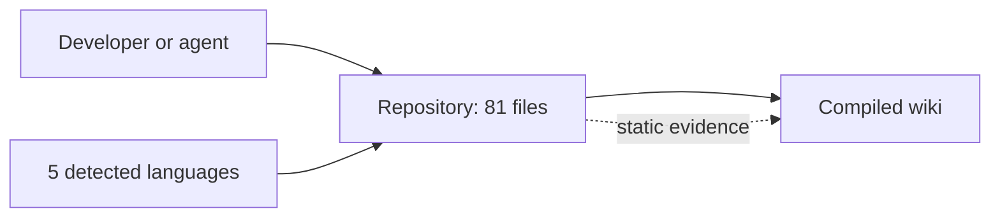
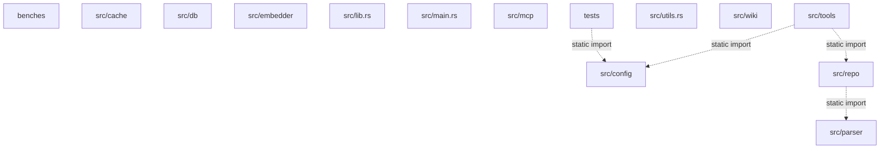
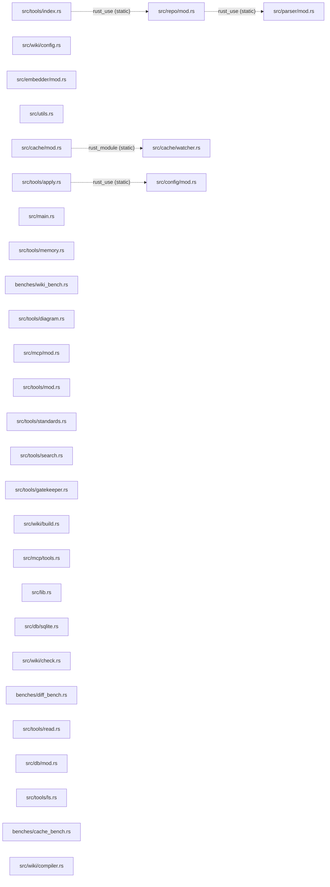
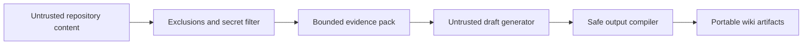

- Source-backed evidence `evidence-0039e1b10de77492b1e8812c11ab527b92f1e95ab8c86f7a04943639673c7eb9` is available.
- Source-backed evidence `evidence-030f410860d98272da65e61c086adacda206bccb727d368fe64def8569e7d587` is available.
- Source-backed evidence `evidence-0343c3150b863d680873debe8103854b15568595acede88c2a4161161abc549d` is available.
- Source-backed evidence `evidence-051b252a6366d6effb03637c72e94a3edbd4eaefeaf6e50b64ac83c43e03ac92` is available.
- Source-backed evidence `evidence-06119225d06338a67f59e990bb43a33d03f360afc5c40f16e4e2837d4e399f1d` is available.
- Source-backed evidence `evidence-089ae1ba0eb98ec3f9151e49ae58d9c403b99378a250079723cd39cb25c5272f` is available.
- Source-backed evidence `evidence-0b893179983f5e8b93023cd95e2b9ac281ad5439904226f832c397ba8be17a59` is available.
- Source-backed evidence `evidence-0be608f3d683b84c1bcbb4e64ece68633cdd7a9a0527f2879c3b06aba1be9f3e` is available.
- Source-backed evidence `evidence-0c2d9d50615068cc6e0efd15d543017e55c95d84d6105702b8bc21547bc11e2e` is available.
- Source-backed evidence `evidence-0c3165578e9e1d19e71a6bffe118feecaeca8e12d14f9555e9f2fb343ac5d5d6` is available.
- Source-backed evidence `evidence-0cacc4105f5382910f29fd9bf9f6cfb31b61d1c050a31c257ff9db387c45e862` is available.
- Source-backed evidence `evidence-111de24738406ce0c9cc434e7d97e1b4ef83bb6c70c7b50aeec1e3dd551a4335` is available.
- Source-backed evidence `evidence-11c1d030634a20828f4dec17cf2abeb75332d7c5b86be809c70ac73a86d4d127` is available.
- Source-backed evidence `evidence-12dea0cd13672f49cbb1b3c10804a7b6689c5b207fc6bfc2d29b98bdd5379811` is available.
- Source-backed evidence `evidence-13307b3c9088cd4d6e6d14a2fe524c8403e4860bcd9da954d8c57087de0b590c` is available.
- Source-backed evidence `evidence-13db296bf7c43c4292f441c8db5f4d71726f35e61aea40a39c123564d03b376a` is available.
- Source-backed evidence `evidence-16ba932a0b8b2e1fe10568209a199b6b521198adfc617d2f7637ce04bb0165b2` is available.
- Source-backed evidence `evidence-18404683a63afeea15347b3575b02b77a5f0cc64cba396721dbbf4e6298c9f19` is available.
- Source-backed evidence `evidence-19b3248e24c90bcc6c7095f12fa6f14b1bad945295a2b259be733aa80ae1e88f` is available.
- Source-backed evidence `evidence-1c88e0969711ae1cfdc968d3dedb1477a205d0853e3c45c198cb3dfd73a29080` is available.
- Source-backed evidence `evidence-1eb41993b5bcc6c8ac7eb4a340fc6b7f0ca816f5d60df779e3c5f472d0104d2d` is available.
- Source-backed evidence `evidence-1f390351de6e3902fa53ffe30cb4906df25ec731ae3491df0861d154a4421205` is available.
- Source-backed evidence `evidence-1f75f786b56aae2f6b402906cc85cf73fc1a9ba7466db62b1e2fa5fa428c26a7` is available.
- Source-backed evidence `evidence-22e39e39c59e544d54d86c3160c10958869bd06c7cd1aaf24a50f76abd10cc6d` is available.
- Source-backed evidence `evidence-2738b0f8ec46dd0a515ed278c0a4b94d94372e09ddb3697ad979d5c21721e337` is available.
- Source-backed evidence `evidence-292a9f953f0c7e022bc3e8a0e48f23397032788da396669ae3a477e84319e4fa` is available.
- Source-backed evidence `evidence-2a0f65a7cd486b29abc67da7d70d807a68acd5667d571db7b2695adc87a7ae1c` is available.
- Source-backed evidence `evidence-2a11e8d7c89a32084500bf682cbf3cbe75f995ca4578beab453f049fe756367e` is available.
- Source-backed evidence `evidence-2b1a6f88c04e802a47448deaacad81b934d952be7f0cb59dabd8fc2ddac4d7a8` is available.
- Source-backed evidence `evidence-2cb0309b91c06ec358737eb56f94f28eb698fa693f88788af40712236217a6d8` is available.
- Source-backed evidence `evidence-2cf87e9c9f9bcff204e3b5b42e4281021b4386a79dfe5c8feade243f1dc6dcc3` is available.
- Source-backed evidence `evidence-2d630a8accb9ab6efe8a070fc00c8dadb8f201659735328ffba60056b007b3b5` is available.
- Source-backed evidence `evidence-2debd1b20289d6fcf3bd156522d5c92e5907af3cfaadd2eea3a66003ef9d91b4` is available.
- Source-backed evidence `evidence-30c2f0b1a51e809ec1a3fe160fd308ced3cf89b9db896d3589529ba1e337f6a6` is available.
- Source-backed evidence `evidence-31594c0cf1b4a6b7857be513c21c7514d4296f63785cd5cd791218b79b1640d1` is available.
- Source-backed evidence `evidence-31df93b61efda141817bd0f58afb77f109d5634e90494fe9028b10d55913fd65` is available.
- Source-backed evidence `evidence-32cdeac1b511905c6e231cc4e5c67ab9f69083e6a5043c38624009feff358f2f` is available.
- Source-backed evidence `evidence-33104ff634e6f12bb771896c670505f6f190c1738ea23b7c3f611a7241a27e67` is available.
- Source-backed evidence `evidence-33c61e280bf2d779aa16e26799fd70b684f48b8bac789a3cfd9223d08714ac96` is available.
- Source-backed evidence `evidence-36dd4a4adafa65adf445930b49aa0bba9a46a5a242a49d70337581d89b52263c` is available.
- Source-backed evidence `evidence-38640d05975ecd2aa1f33abc62d1979a0178a5caa44848c7cf4767da27ebcadb` is available.
- Source-backed evidence `evidence-3a1b244d1e96151e1a6128c651c79cf2e201a82eda02a9dd11ab0401f7438187` is available.
- Source-backed evidence `evidence-3a53af775555222d4b92c902254e22ad9c02cbd23c946b5a36e1f8bc8af64bae` is available.
- Source-backed evidence `evidence-3b9ec2e00ec7fdaa13f7eef663708a9577af0a8cd381ed64bda949bf6f73583e` is available.
- Source-backed evidence `evidence-3c126e37116ca3b089b1654078083d8879d45ec54b8ef308ae5fd9d72d503dde` is available.
- Source-backed evidence `evidence-3cdb801c8377d76d10a2ae194540b38196c8792bbd570635449e4a931ed643ad` is available.
- Source-backed evidence `evidence-3e3dc467b533d0079725fce341ce67368e52f55ce78b152e315924b85c1a7df2` is available.
- Source-backed evidence `evidence-3e8cbb6245362c569bde0539b4fa45caafa9b29cd2acf2719b2aba9edacfc55f` is available.
- Source-backed evidence `evidence-3fb4b8559bae9bda7fcf032a67b4a942bee7b6eef2eb0ded3f59a9a100e9e41a` is available.
- Source-backed evidence `evidence-40919adb0be92e4c7fd939fd2626d9ada3bb0ae9e253837f51933ba42b2e8d17` is available.
- Source-backed evidence `evidence-41cf935f7115d7e1f0c7c1f118044f51ccbf82c4b2359c4f6eaaa70113207d16` is available.
- Source-backed evidence `evidence-42c4f8af5981a5586c8acf96d5384a5a54b5a6370df111bb2579aff74ff43958` is available.
- Source-backed evidence `evidence-430fd915c79c8fa9570551a32c5689e449ad7b87b8e47c8ff1300980d5e0ba3e` is available.
- Source-backed evidence `evidence-4381d88734d87a454fe8d0d648dc82ab38340a4150943a9dbe5e839fe789b7ee` is available.
- Source-backed evidence `evidence-443baed4d1116b044c0d33bfd89441242c46a70da152a81cb8f09e1e11da44be` is available.
- Source-backed evidence `evidence-453ebeaf4df2d5e9355f0c9f4c93d4e4eb5f3d2f772d52993aaa0559524fac1b` is available.
- Source-backed evidence `evidence-46a23bb7cf884c9a6e8416753d4b7b54ae5d596e0c8276552e50299b069c0004` is available.
- Source-backed evidence `evidence-47a186046dbfad46e3595df8502e25827d40de3b5581143e1e574de1d1825e96` is available.
- Source-backed evidence `evidence-47d9853390c9efbb3d3a4718a48b3f472aa0df9d210675f85e55bf59d1618201` is available.
- Source-backed evidence `evidence-48c0660f9eeb26d5c2dc0526a6767a003500ff2fc27e2c8d0de2dc9d0b9a4404` is available.
- Source-backed evidence `evidence-4e5057a9b83e83689f66ab4e8cbdc304a447fea216aed7d2d817632e27d43e5c` is available.
- Source-backed evidence `evidence-4e87415d36bf0396cc00679eef283add8262b08d9c4fb0cb6ae4f8ffb0da63cf` is available.
- Source-backed evidence `evidence-4f16fc37bd968e0c905c23d5e5cb5f828a73afd4bc8b7b63a08970abcf36da4f` is available.
- Source-backed evidence `evidence-4f69a6c3c1c8b6f64e8be659e5aa79586b1811a15539622ba5936b4a8064cd71` is available.

## Architecture Story

### Context

### Subsystems

### Static Dependencies

### Security Boundaries

## Evidence

- `evidence-0039e1b10de77492b1e8812c11ab527b92f1e95ab8c86f7a04943639673c7eb9`: `src/tools/gatekeeper.rs`
- `evidence-030f410860d98272da65e61c086adacda206bccb727d368fe64def8569e7d587`: `src/wiki/mod.rs`
- `evidence-0343c3150b863d680873debe8103854b15568595acede88c2a4161161abc549d`: `src/wiki/check.rs`
- `evidence-051b252a6366d6effb03637c72e94a3edbd4eaefeaf6e50b64ac83c43e03ac92`: `src/tools/mod.rs`
- `evidence-06119225d06338a67f59e990bb43a33d03f360afc5c40f16e4e2837d4e399f1d`: `src/wiki/evidence.rs`
- `evidence-089ae1ba0eb98ec3f9151e49ae58d9c403b99378a250079723cd39cb25c5272f`: `tests/fixtures/wiki/rust-basic/src/lib.rs`
- `evidence-0b893179983f5e8b93023cd95e2b9ac281ad5439904226f832c397ba8be17a59`: `tests/fixtures/wiki/rename-delete/baseline/src/shared.rs`
- `evidence-0be608f3d683b84c1bcbb4e64ece68633cdd7a9a0527f2879c3b06aba1be9f3e`: `src/wiki/evidence.rs`
- `evidence-0c2d9d50615068cc6e0efd15d543017e55c95d84d6105702b8bc21547bc11e2e`: `tests/fixtures/wiki/shared-dependency/baseline/src/index.ts`
- `evidence-0c3165578e9e1d19e71a6bffe118feecaeca8e12d14f9555e9f2fb343ac5d5d6`: `src/wiki/config.rs`
- `evidence-0cacc4105f5382910f29fd9bf9f6cfb31b61d1c050a31c257ff9db387c45e862`: `src/tools/read.rs`
- `evidence-111de24738406ce0c9cc434e7d97e1b4ef83bb6c70c7b50aeec1e3dd551a4335`: `src/tools/index.rs`
- `evidence-11c1d030634a20828f4dec17cf2abeb75332d7c5b86be809c70ac73a86d4d127`: `tests/fixtures/wiki/shared-dependency/baseline/src/api.ts`
- `evidence-12dea0cd13672f49cbb1b3c10804a7b6689c5b207fc6bfc2d29b98bdd5379811`: `tests/fixtures/wiki/shared-dependency/updated/src/shared.ts`
- `evidence-13307b3c9088cd4d6e6d14a2fe524c8403e4860bcd9da954d8c57087de0b590c`: `src/lib.rs`
- `evidence-13db296bf7c43c4292f441c8db5f4d71726f35e61aea40a39c123564d03b376a`: `src/wiki/check.rs`
- `evidence-16ba932a0b8b2e1fe10568209a199b6b521198adfc617d2f7637ce04bb0165b2`: `src/mcp/tools.rs`
- `evidence-18404683a63afeea15347b3575b02b77a5f0cc64cba396721dbbf4e6298c9f19`: `src/mcp/tools.rs`
- `evidence-19b3248e24c90bcc6c7095f12fa6f14b1bad945295a2b259be733aa80ae1e88f`: `src/repo/mod.rs`
- `evidence-1c88e0969711ae1cfdc968d3dedb1477a205d0853e3c45c198cb3dfd73a29080`: `src/main.rs`
- `evidence-1eb41993b5bcc6c8ac7eb4a340fc6b7f0ca816f5d60df779e3c5f472d0104d2d`: `src/wiki/state.rs`
- `evidence-1f390351de6e3902fa53ffe30cb4906df25ec731ae3491df0861d154a4421205`: `src/wiki/mod.rs`
- `evidence-1f75f786b56aae2f6b402906cc85cf73fc1a9ba7466db62b1e2fa5fa428c26a7`: `src/lib.rs`
- `evidence-22e39e39c59e544d54d86c3160c10958869bd06c7cd1aaf24a50f76abd10cc6d`: `src/wiki/update.rs`
- `evidence-2738b0f8ec46dd0a515ed278c0a4b94d94372e09ddb3697ad979d5c21721e337`: `tests/fixtures/wiki/python-basic/tests/test_service.py`
- `evidence-292a9f953f0c7e022bc3e8a0e48f23397032788da396669ae3a477e84319e4fa`: `tests/fixtures/wiki/no-trusted-docs/src/worker.py`
- `evidence-2a0f65a7cd486b29abc67da7d70d807a68acd5667d571db7b2695adc87a7ae1c`: `src/tools/memory.rs`
- `evidence-2a11e8d7c89a32084500bf682cbf3cbe75f995ca4578beab453f049fe756367e`: `src/wiki/update.rs`
- `evidence-2b1a6f88c04e802a47448deaacad81b934d952be7f0cb59dabd8fc2ddac4d7a8`: `src/wiki/compiler.rs`
- `evidence-2cb0309b91c06ec358737eb56f94f28eb698fa693f88788af40712236217a6d8`: `tests/fixtures/wiki/typescript-basic/src/index.ts`
- `evidence-2cf87e9c9f9bcff204e3b5b42e4281021b4386a79dfe5c8feade243f1dc6dcc3`: `tests/fixtures/wiki/mixed-monorepo/packages/api/src/server.ts`
- `evidence-2d630a8accb9ab6efe8a070fc00c8dadb8f201659735328ffba60056b007b3b5`: `src/mcp/tools.rs`
- `evidence-2debd1b20289d6fcf3bd156522d5c92e5907af3cfaadd2eea3a66003ef9d91b4`: `tests/integration_tests.rs`
- `evidence-30c2f0b1a51e809ec1a3fe160fd308ced3cf89b9db896d3589529ba1e337f6a6`: `src/db/mod.rs`
- `evidence-31594c0cf1b4a6b7857be513c21c7514d4296f63785cd5cd791218b79b1640d1`: `src/parser/mod.rs`
- `evidence-31df93b61efda141817bd0f58afb77f109d5634e90494fe9028b10d55913fd65`: `tests/fixtures/wiki/shared-dependency/updated/src/index.ts`
- `evidence-32cdeac1b511905c6e231cc4e5c67ab9f69083e6a5043c38624009feff358f2f`: `src/wiki/check.rs`
- `evidence-33104ff634e6f12bb771896c670505f6f190c1738ea23b7c3f611a7241a27e67`: `src/cache/watcher.rs`
- `evidence-33c61e280bf2d779aa16e26799fd70b684f48b8bac789a3cfd9223d08714ac96`: `src/tools/apply.rs`
- `evidence-36dd4a4adafa65adf445930b49aa0bba9a46a5a242a49d70337581d89b52263c`: `src/wiki/realm.rs`
- `evidence-38640d05975ecd2aa1f33abc62d1979a0178a5caa44848c7cf4767da27ebcadb`: `src/wiki/planner.rs`
- `evidence-3a1b244d1e96151e1a6128c651c79cf2e201a82eda02a9dd11ab0401f7438187`: `src/embedder/mod.rs`
- `evidence-3a53af775555222d4b92c902254e22ad9c02cbd23c946b5a36e1f8bc8af64bae`: `tests/fixtures/wiki/python-basic/src/models.py`
- `evidence-3b9ec2e00ec7fdaa13f7eef663708a9577af0a8cd381ed64bda949bf6f73583e`: `src/wiki/planner.rs`
- `evidence-3c126e37116ca3b089b1654078083d8879d45ec54b8ef308ae5fd9d72d503dde`: `src/wiki/evidence.rs`
- `evidence-3cdb801c8377d76d10a2ae194540b38196c8792bbd570635449e4a931ed643ad`: `src/tools/search.rs`
- `evidence-3e3dc467b533d0079725fce341ce67368e52f55ce78b152e315924b85c1a7df2`: `tests/fixtures/wiki/go-basic/service.go`
- `evidence-3e8cbb6245362c569bde0539b4fa45caafa9b29cd2acf2719b2aba9edacfc55f`: `tests/fixtures/wiki/shared-dependency/updated/src/api.ts`
- `evidence-3fb4b8559bae9bda7fcf032a67b4a942bee7b6eef2eb0ded3f59a9a100e9e41a`: `src/wiki/model.rs`
- `evidence-40919adb0be92e4c7fd939fd2626d9ada3bb0ae9e253837f51933ba42b2e8d17`: `src/wiki/mod.rs`
- `evidence-41cf935f7115d7e1f0c7c1f118044f51ccbf82c4b2359c4f6eaaa70113207d16`: `src/wiki/update.rs`
- `evidence-42c4f8af5981a5586c8acf96d5384a5a54b5a6370df111bb2579aff74ff43958`: `benches/wiki_bench.rs`
- `evidence-430fd915c79c8fa9570551a32c5689e449ad7b87b8e47c8ff1300980d5e0ba3e`: `src/wiki/mod.rs`
- `evidence-4381d88734d87a454fe8d0d648dc82ab38340a4150943a9dbe5e839fe789b7ee`: `src/wiki/mod.rs`
- `evidence-443baed4d1116b044c0d33bfd89441242c46a70da152a81cb8f09e1e11da44be`: `src/lib.rs`
- `evidence-453ebeaf4df2d5e9355f0c9f4c93d4e4eb5f3d2f772d52993aaa0559524fac1b`: `src/wiki/state.rs`
- `evidence-46a23bb7cf884c9a6e8416753d4b7b54ae5d596e0c8276552e50299b069c0004`: `src/wiki/build.rs`
- `evidence-47a186046dbfad46e3595df8502e25827d40de3b5581143e1e574de1d1825e96`: `src/wiki/safety.rs`
- `evidence-47d9853390c9efbb3d3a4718a48b3f472aa0df9d210675f85e55bf59d1618201`: `src/wiki/planner.rs`
- `evidence-48c0660f9eeb26d5c2dc0526a6767a003500ff2fc27e2c8d0de2dc9d0b9a4404`: `src/wiki/check.rs`
- `evidence-4e5057a9b83e83689f66ab4e8cbdc304a447fea216aed7d2d817632e27d43e5c`: `src/wiki/mod.rs`
- `evidence-4e87415d36bf0396cc00679eef283add8262b08d9c4fb0cb6ae4f8ffb0da63cf`: `src/wiki/generator.rs`
- `evidence-4f16fc37bd968e0c905c23d5e5cb5f828a73afd4bc8b7b63a08970abcf36da4f`: `tests/fixtures/wiki/typescript-basic/src/math.ts`
- `evidence-4f69a6c3c1c8b6f64e8be659e5aa79586b1811a15539622ba5936b4a8064cd71`: `src/wiki/evidence.rs`
