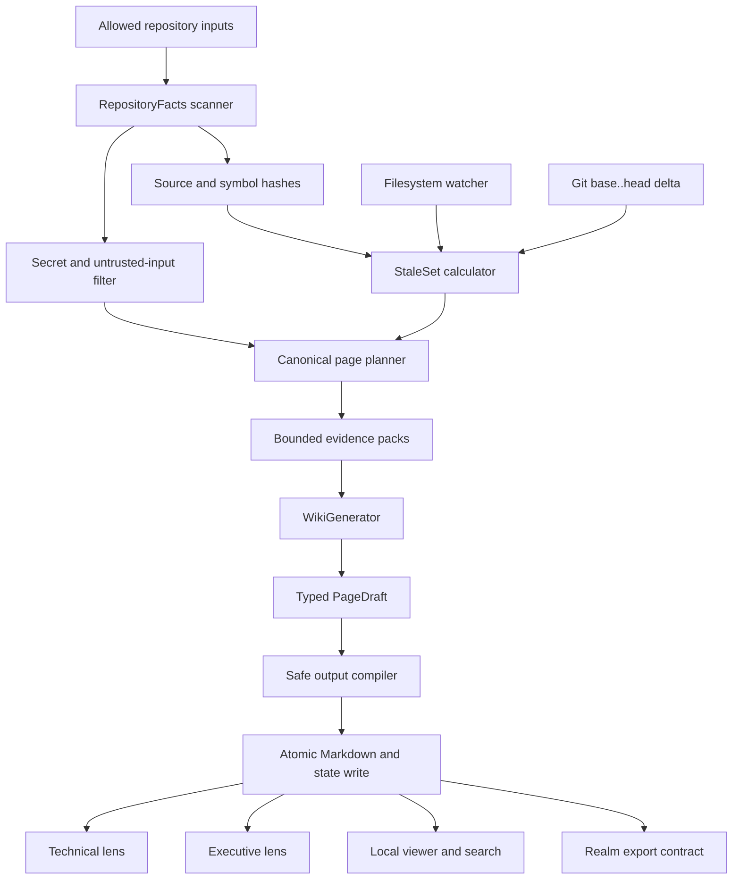
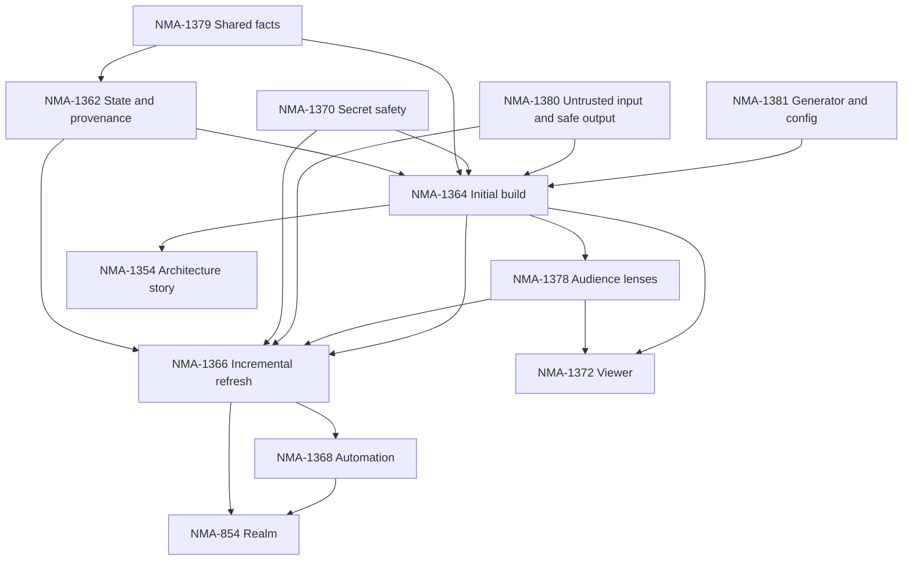

# Klaar Compiled Wiki Implementation Plan

- Status: Planned
- Primary scope: [NMA-853](https://linear.app/nmavc/issue/NMA-853/compiled-repository-wiki-initial-build-incremental-refresh-klaar)
- Linear plan: [Klaar compiled wiki implementation plan](https://linear.app/nmavc/document/klaar-compiled-wiki-implementation-plan-d003ed8c966e)

## 1. Objective

Build a local-first, repository-native wiki compiler that:

- discovers bounded, deterministic facts from a codebase;
- creates a stable canonical knowledge and provenance graph;
- renders technical and executive/plain-language Markdown from the same knowledge;
- keeps generated pages current from filesystem and Git changes;
- exposes exact provenance and staleness reasons;
- prevents source code, secrets, or prompt injection from controlling generated writes;
- works through the CLI, MCP hosts, and non-interactive CI;
- remains portable Markdown that can be read without Klaar;
- provides a local read-only viewer and search experience; and
- establishes the versioned per-repository contract consumed by the future Realm layer.

The core design is a compiler, not an autonomous documentation agent. A model may
propose explanations from a bounded evidence pack. Deterministic Klaar code decides
what evidence is available, what pages exist, what becomes stale, what citations are
valid, where files are written, and whether output is safe.

## 2. Target Experience

Initial setup:

```bash
cd repository
klaar wiki init
klaar wiki build
```

Normal development:

```text
edit source
  -> watcher marks canonical pages and lens renderings stale
  -> pre-push refreshes or reports the affected pages
  -> CI verifies the committed wiki against base..head
  -> unchanged pages remain byte-identical
```

Human inspection:

```bash
klaar wiki serve
```

The viewer opens a local read-only site with:

- technical and executive lens switching;
- Markdown navigation;
- Mermaid diagrams;
- local full-text search;
- current/stale state;
- page-to-source provenance; and
- no cloud service or telemetry requirement.

## 3. Scope

### 3.1 Per-repository wiki MVP

- Stable repository facts and evidence graph.
- Versioned manifest and provenance state.
- Secret-safe and prompt-injection-safe generation boundary.
- Full initial build.
- Technical lens.
- Executive/plain-language lens.
- Incremental Git-diff refresh.
- Filesystem watcher invalidation.
- Pre-push and CI freshness checks.
- Local read-only viewer and search.
- Existing overview, dependencies, and hotspots Mermaid views.
- Cross-platform tests and reproducible benchmarks.

### 3.2 Follow-on scope

- Runtime-flow and architecture-story diagrams from [NMA-1354](https://linear.app/nmavc/issue/NMA-1354/add-architecture-story-and-runtime-flow-mermaid-views).
- Realm federation from [NMA-854](https://linear.app/nmavc/issue/NMA-854/realm-layer-cross-repo-knowledge-base-for-the-fleet-klaar).
- Additional lenses such as operator and newcomer after the two MVP lenses are stable.

### 3.3 Non-goals

- Hosted documentation SaaS.
- Collaborative manual wiki editing.
- Replacing human-authored ADRs, specifications, or product documents.
- Runtime tracing presented as static certainty.
- Arbitrary external research or ticket ingestion into the repository wiki.
- Business, customer, strategy, or impact claims unsupported by configured evidence.
- Letting a model select commands, source files, output paths, or filesystem writes.

## 4. Engineering Principles

### 4.1 Deterministic control plane

Klaar deterministically controls:

- repository scanning;
- exclusions and path boundaries;
- stable identities and ordering;
- page planning;
- evidence selection;
- stale-page calculation;
- lens fan-out;
- citation validation;
- output paths;
- Markdown/Mermaid validation; and
- atomic writes.

### 4.2 Bounded model use

The generator receives one versioned page request with a bounded evidence pack and
returns one typed page draft. It has no tools, shell access, filesystem authority, or
access to omitted evidence.

### 4.3 One knowledge graph, multiple lenses

Technical and executive Markdown are renderings of the same canonical page. They do
not maintain separate facts, source hashes, provenance edges, or stale state.

### 4.4 Fail closed

If Klaar cannot prove that an input is in bounds or an output is safe and valid, it
omits or rejects the material and emits a diagnostic. It does not silently widen the
prompt, persist suspicious content, or write a partial state transition.

### 4.5 Portable artifacts

Generated Markdown is useful in GitHub, editors, other MCP hosts, and plain file
readers. Machine state is kept separately so human-readable pages are not the database.

## 5. Current Repository Gaps

The current code provides useful primitives, but they are not yet a wiki compiler:

- `src/tools/index.rs` has symbol names and locations but no stable qualified IDs,
  source ranges, hashes, or dependency edges.
- `src/tools/diagram.rs` owns a separate private file/import graph.
- The two scanners cannot yet provide one durable provenance contract.
- `src/cache/watcher.rs` invalidates caches but does not publish semantic wiki events.
- Project configuration only covers validation targets, not wiki policy.
- Klaar embeds text for search but has no text-generation provider abstraction.
- No output compiler validates typed claims, citations, Markdown, Mermaid, or paths.
- No atomic multi-page/state transaction exists.
- No wiki CLI, MCP protocol, viewer, or quality evaluation harness exists.

The first implementation work must close these seams instead of placing wiki logic in
`src/mcp/tools.rs` or duplicating the existing scanners.

## 6. Target Architecture



### 6.1 Suggested module layout

```text
src/
  repo/
    mod.rs
    facts.rs
    scan.rs
    symbols.rs
    dependencies.rs
    manifests.rs
  wiki/
    mod.rs
    config.rs
    model.rs
    state.rs
    safety.rs
    planner.rs
    evidence.rs
    generator.rs
    compiler.rs
    build.rs
    update.rs
    check.rs
    viewer.rs
```

CLI and MCP handlers remain thin adapters over the same library API. The viewer reads
compiled artifacts and state; it does not implement a second wiki model.

## 7. Core Data Contracts

All persisted contracts carry an explicit schema version. Collections are sorted before
serialization, repository paths use normalized `/` separators, and stable IDs do not
depend on generated wording.

### 7.1 Repository facts

```rust
struct RepositoryFacts {
    schema_version: u32,
    repository_id: RepositoryId,
    files: Vec<FileFact>,
    symbols: Vec<SymbolFact>,
    dependencies: Vec<DependencyEdge>,
    manifests: Vec<ManifestFact>,
    trusted_docs: Vec<TrustedDocFact>,
    components: Vec<ComponentCandidate>,
    diagnostics: Vec<ScanDiagnostic>,
}
```

Minimum fact metadata:

- normalized repository-relative path;
- language and file kind;
- content hash;
- stable symbol ID, qualified name, kind, and source range;
- static import/module dependency edges with evidence location;
- manifest/build/test commands discovered from trusted structured configuration;
- trusted-document identity and hash; and
- explicit truncation or unsupported-language diagnostics.

### 7.2 Evidence reference

```rust
struct EvidenceRef {
    id: EvidenceId,
    source: SourceIdentity,
    range: Option<SourceRange>,
    content_hash: ContentHash,
    evidence_kind: EvidenceKind,
}
```

The generator receives opaque evidence IDs. It cannot invent new sources or paths.

### 7.3 Canonical page

```rust
struct CanonicalPageState {
    page_id: PageId,
    page_kind: PageKind,
    title: String,
    evidence: Vec<EvidenceRef>,
    related_pages: Vec<PageId>,
    evidence_hash: ContentHash,
    structured_claims: Vec<SupportedClaim>,
}
```

Canonical state captures supported meaning and relationships independently of technical
or executive wording.

### 7.4 Lens rendering

```rust
struct LensRenderState {
    page_id: PageId,
    lens: LensId,
    evidence_hash: ContentHash,
    content_hash: ContentHash,
    generator: GeneratorReceipt,
    output_path: RelativeWikiPath,
}
```

### 7.5 Manifest

`WikiManifestV1` contains:

- schema and Klaar versions;
- repository identity;
- configured lenses;
- canonical page records;
- lens render records;
- forward and reverse evidence dependencies;
- source hashes;
- generation receipts;
- state creation/update times excluded from deterministic content hashes; and
- diagnostics and migration status.

## 8. Configuration

### 8.1 Repository configuration

File: `.klaar/wiki.toml`

```toml
[wiki]
enabled = true
lenses = ["technical", "executive"]
output_dir = ".klaar/wiki"
state_dir = ".klaar/wiki-state"
max_pages = 100
max_evidence_bytes_per_page = 131072
max_output_bytes_per_page = 32768

[wiki.documents]
trusted = [
  "README.md",
  "docs/**/*.md",
  "adr/**/*.md",
]
exclude = [
  "**/.env*",
  "**/secrets/**",
  "**/fixtures/private/**",
]

[wiki.automation]
watcher = "mark-stale"
pre_push = "update"
ci = "check"
```

Repository configuration may control lenses, trusted-document globs, exclusions,
budgets, component hints, and automation policy. It may not configure credentials,
arbitrary executables, remote endpoints, shell commands, or paths outside `.klaar/`.

### 8.2 Global configuration

Global user configuration owns:

- generator adapter;
- executable and argument array or API endpoint;
- credential environment-variable names;
- timeout, retry, concurrency, and cost limits;
- optional external secret detector; and
- viewer bind policy.

Credentials are read from the environment or operating-system credential facilities and
are never copied into repository state, generated Markdown, diagnostics, or receipts.

## 9. Generator Contract

```rust
trait WikiGenerator {
    async fn generate(
        &self,
        request: PageGenerationRequest,
    ) -> anyhow::Result<PageDraft>;
}
```

### 9.1 Required adapters

1. `FactRenderer`
   - deterministic and model-free;
   - used for unit/golden tests and degraded technical output;
   - proves the compiler without network or model variance.

2. MCP-assisted generator
   - host agent requests a planned evidence pack;
   - host submits a typed draft through an MCP tool;
   - compiler validates and writes through the same pipeline.

3. Headless command generator
   - executable and args come from global configuration;
   - direct process execution, never a shell;
   - versioned JSON on stdin/stdout;
   - timeout, output cap, concurrency cap, and sanitized diagnostics;
   - supports local models or user-supplied provider wrappers in CLI/CI.

Direct provider adapters can be added later without changing compiler/state contracts.

### 9.2 No-op guarantee

If the page plan, evidence hash, lens contract, and relevant generator configuration are
unchanged, Klaar does not invoke the generator and does not rewrite the output file.

## 10. Security Model

### 10.1 Input exclusions

Hard exclusions apply before file contents are read:

- `.env` variants;
- private keys and certificate key material;
- credential/config stores;
- `.git` internals;
- build/vendor/generated output;
- files outside allowed roots;
- symlink escapes;
- files over configured limits; and
- binary or unsupported content.

Configured excludes can only narrow the input set. They cannot override hard exclusions.

### 10.2 Secret detection

Run detection:

1. before evidence enters any generator request; and
2. after draft generation but before Markdown is written.

Diagnostics identify the file/evidence ID and detector category without echoing the
suspected value. Uncertain material is omitted rather than persisted.

### 10.3 Prompt injection

Repository content is untrusted data, even when it is a README or source comment.

- Evidence is framed as quoted data with opaque IDs.
- The generator cannot request more files or execute tools.
- The generator cannot choose page IDs or output paths.
- Only citations from the supplied evidence set are accepted.
- Instructions contained inside evidence have no authority.

### 10.4 Safe output compiler

Before write, reject or sanitize:

- unknown page or evidence IDs;
- path traversal and absolute output paths;
- raw active HTML;
- `javascript:`, unsafe `data:`, and unsupported URL schemes;
- malformed or model-controlled front matter;
- Mermaid directives or labels that escape the supported subset;
- oversized sections, links, or code blocks; and
- source/config dumps outside explicit bounded excerpt policy.

The compiler, not the model, constructs front matter, citations, links, and output paths.

### 10.5 Atomicity and recovery

- Hold one repository-scoped wiki update lock.
- Generate into a staging directory.
- Validate the complete changed set.
- `fsync` where practical.
- Atomically swap changed artifacts.
- Persist state only after artifact success.
- Recover or discard incomplete staging directories on the next run.

## 11. CLI and MCP Surface

### 11.1 CLI

```text
klaar wiki init [--project PATH]
klaar wiki build [--project PATH] [--lens LENS]
klaar wiki update --base REV --head REV [--project PATH]
klaar wiki check --base REV --head REV [--project PATH]
klaar wiki status [--project PATH] [--json]
klaar wiki explain-stale PAGE_ID [--project PATH]
klaar wiki serve [--project PATH] [--port PORT]
```

`build`, `update`, and `check` have machine-readable JSON output modes for CI.

### 11.2 MCP

Recommended tools:

- `wiki_status`
- `wiki_list_pages`
- `wiki_read_page`
- `wiki_get_evidence`
- `wiki_plan_build`
- `wiki_submit_page_draft`
- `wiki_explain_stale`

MCP tools enforce the same `allowed_roots`, budgets, state lock, safety compiler, and
generator contracts as CLI operations.

## 12. Incremental Refresh Algorithm

Canonical flow:

```text
git base..head or watcher event
  -> changed, added, removed, renamed files
  -> changed/removed symbols and dependency edges
  -> reverse provenance lookup
  -> directly affected canonical pages
  -> bounded dependency fan-out
  -> configured lens renderings
  -> bounded evidence rebuild
  -> selective generation
  -> safe compilation and atomic commit
```

Rules:

- Page selection never depends on an LLM.
- Every stale page records one or more `StaleReason` values.
- Unaffected pages and lens files remain byte-identical.
- Renames preserve identity when deterministic evidence supports it.
- Deletes remove orphaned pages, renderings, and reverse edges.
- Shared dependency changes may fan out to multiple pages, but the fan-out is bounded and
  reported.
- Missing, corrupt, or incompatible state triggers an explicit wider rebuild. Klaar does
  not silently miss affected pages.

## 13. Artifact Layout

```text
.klaar/
  wiki.toml
  wiki/
    technical/
      index.md
      architecture.md
      dependencies.md
      testing.md
      operations.md
      components/
    executive/
      index.md
      capabilities.md
      workflows.md
      dependencies.md
      risks.md
  wiki-state/
    manifest.json
    repository-facts.json
    provenance.json
    source-hashes.json
```

A deduplicated internal representation is acceptable, but generated Markdown must remain
portable and each lens/page identity must be explicit.

## 14. Delivery Plan

### Phase 0: Contracts, configuration, and fixtures

Linear issues:

- [NMA-1379](https://linear.app/nmavc/issue/NMA-1379/shared-repository-facts-and-evidence-graph-for-wiki-compilation)
- [NMA-1381](https://linear.app/nmavc/issue/NMA-1381/headless-wiki-generator-and-configuration-contract)

Work:

- Add `src/repo/` and `src/wiki/` module skeletons.
- Define versioned facts, evidence, page, lens, state, and generator contracts.
- Define and validate `.klaar/wiki.toml`.
- Refactor current symbol/import scanners behind a shared facts API.
- Preserve `find_symbol` and `diagram_codebase` via adapters.
- Add small fixture repositories for each supported language and mixed/monorepo cases.
- Add deterministic serialization and a model-free fact renderer.
- Add CLI command skeletons with actionable unconfigured errors.

Exit gate:

- Identical inputs serialize to byte-identical facts.
- Fixtures require no network or model.
- Existing symbol and diagram behavior remains compatible.
- Configuration cannot escape repository or global trust boundaries.

Estimate: 3-5 engineering days.

### Phase 1: Safety and durable state

Linear issues:

- [NMA-1370](https://linear.app/nmavc/issue/NMA-1370/secret-safe-wiki-generation-boundary)
- [NMA-1380](https://linear.app/nmavc/issue/NMA-1380/treat-repository-evidence-as-untrusted-input-and-compile-safe-wiki)
- [NMA-1362](https://linear.app/nmavc/issue/NMA-1362/wiki-state-provenance-graph)

Work:

- Implement hard exclusions and canonical-path enforcement.
- Implement pre-generation and pre-write secret detection.
- Implement typed `PageDraft` validation.
- Implement safe Markdown, link, front matter, and Mermaid compilation.
- Implement stable page IDs and forward/reverse provenance.
- Implement source/lens hashes and stale diagnostics.
- Implement versioned state and explicit migration/rebuild behavior.
- Implement atomic multi-page/state writes and recovery.

Exit gate:

- Adversarial fixtures cannot persist secrets, active content, path escapes, or unknown
  citations.
- Source-to-page and page-to-evidence queries work.
- Rename/delete operations leave no orphaned state.
- Machine state is byte-identical for identical repository facts.

Estimate: 5-8 engineering days.

### Phase 2: Initial technical vertical slice

Linear issue:

- [NMA-1364](https://linear.app/nmavc/issue/NMA-1364/initial-compiled-wiki-build)

Work:

- Build a deterministic information architecture from repository facts.
- Create bounded per-page evidence plans.
- Implement fact-renderer, MCP-assisted, and headless generation paths.
- Generate technical index, architecture, dependencies, testing, operations, domain, and
  component pages when evidence exists.
- Reuse existing Mermaid overview/dependency/hotspot output.
- Add build receipts, truncation diagnostics, and generator metrics.
- Dogfood the full build against the Klaar repository.

Exit gate:

- A clean checkout builds a coherent technical wiki.
- Empty or unsupported sections are omitted instead of invented.
- Every page exposes provenance.
- Rebuilding unchanged input makes no generator calls and no file diff.
- All per-page and whole-build budgets are enforced.

Estimate: 5-7 engineering days.

### Phase 3: Technical and executive lenses

Linear issue:

- [NMA-1378](https://linear.app/nmavc/issue/NMA-1378/wiki-audience-lenses-technical-executiveplain-language)

Work:

- Add a lens registry and rendering contracts.
- Move technical prose behind the same lens interface.
- Add executive/plain-language rendering.
- Allow configured trusted docs to support purpose, intended users, and rationale.
- Implement evidence-supported-claim validation and omission rules.
- Track lens-specific content hashes, receipts, and budgets.

Exit gate:

- Both lenses derive from one canonical page and evidence set.
- Adding a lens does not alter provenance/staleness state.
- Executive pages do not invent business value, strategy, customers, or outcomes.
- Unaffected lens outputs remain byte-identical.

Estimate: 3-5 engineering days.

### Phase 4: Incremental invalidation and refresh

Linear issue:

- [NMA-1366](https://linear.app/nmavc/issue/NMA-1366/incremental-wiki-invalidation-refresh)

Work:

- Implement Git `base..head` delta discovery with add/remove/rename handling.
- Resolve changed files, symbols, dependencies, and trusted docs.
- Walk reverse provenance to derive the canonical stale set.
- Fan out stale canonical pages to configured lens renderings.
- Regenerate only affected pages.
- Remove obsolete pages and reverse edges.
- Add safe wider-rebuild fallback for missing or incompatible state.

Exit gate:

- Localized edits rebuild only expected pages and lenses.
- Shared changes fan out predictably with diagnostics.
- Unaffected artifacts remain byte-identical.
- Corrupt state fails safely into an explicit rebuild.
- A no-op update invokes no generator.

Estimate: 4-6 engineering days.

### Phase 5: Automatic freshness

Linear issue:

- [NMA-1368](https://linear.app/nmavc/issue/NMA-1368/automagic-wiki-freshness-watcher-pre-push-ci)

Work:

- Generalize watcher events so wiki stale state and cache invalidation share project events.
- Add non-interactive `wiki update`, `wiki check`, `wiki status`, and JSON output.
- Integrate wiki checks with existing project targets and pre-push checks.
- Add documented CI base/head selection.
- Add one-time init/install support.
- Add recursion guards for generated documentation commits.

Recommended policy:

- watcher: mark stale and optionally refresh lazily;
- local pre-push: update or fail according to project policy; and
- CI: verify and fail with remediation, but do not push generated commits by default.

Exit gate:

- Normal edit/commit/push requires no manual documentation command after init.
- Watcher and Git paths calculate the same stale set.
- Failures identify source changes, canonical pages, and lenses.
- No generated-document commit loop is possible.

Estimate: 3-4 engineering days.

### Phase 6: Local viewer and search

Linear issue:

- [NMA-1372](https://linear.app/nmavc/issue/NMA-1372/local-compiled-wiki-viewer-search)

Work:

- Add a read-only localhost HTTP server.
- Render Markdown and Mermaid without remote assets.
- Add navigation and technical/executive lens switching by canonical page ID.
- Add local full-text search over compiled artifacts.
- Add provenance and freshness inspection.
- Add source/symbol links.
- Add strict content security policy and localhost-only binding by default.

Exit gate:

- Browse, search, lens switching, diagrams, provenance, and stale state work offline.
- Viewer contains no write or refresh API.
- Viewer cannot bind publicly without explicit global configuration.
- Malicious fixture content remains inert.

Estimate: 3-5 engineering days.

### Phase 7: Architecture-story enrichment

Linear issue:

- [NMA-1354](https://linear.app/nmavc/issue/NMA-1354/add-architecture-story-and-runtime-flow-mermaid-views)

Work:

- Add context, container/subsystem, primary request flow, data flow, and failure/security
  diagrams.
- Add entry-symbol call-flow diagrams grounded in call-site evidence.
- Visually distinguish static imports, inferred calls, configured commands, and unknown
  runtime relationships.
- Embed the views in canonical technical pages and selectively simplify them for the
  executive lens.
- Add language fixtures and golden diagrams.

This phase is not an MVP blocker. The initial wiki uses the existing structural diagrams.

Estimate: 4-6 engineering days.

### Phase 8: Hardening and release evidence

Work:

- Cross-language and monorepo end-to-end fixtures.
- Property tests for stable IDs, ordering, paths, and invalidation.
- Adversarial secret/prompt/Markdown/Mermaid suite.
- Crash and partial-write recovery tests.
- Concurrent build/update locking tests.
- Watcher storm tests.
- Cold full-build and warm incremental benchmarks.
- Page-quality evaluation with evidence-support scoring.
- Windows, macOS, and Linux verification.
- README, configuration, threat-model, and CI documentation.

Exit gate:

- Security and reliability suites pass on supported platforms.
- Incremental update materially reduces time, evidence volume, and generator calls versus
  full rebuild.
- Published examples have inspectable evidence receipts.
- Wiki release does not regress existing MCP, cache, memory, or diagram behavior.

Estimate: 4-6 engineering days.

### Phase 9: Realm federation

Linear issue:

- [NMA-854](https://linear.app/nmavc/issue/NMA-854/realm-layer-cross-repo-knowledge-base-for-the-fleet-klaar)

Prerequisite: freeze `WikiManifestV1` only after at least two materially different
repositories produce stable compiled wikis.

Work:

- Define a Realm membership manifest.
- Import each repository's canonical page/provenance export without rescanning source.
- Build cross-repository ownership, dependency, shared-contract, and duplicate-pattern
  pages.
- Retain repository-level citations for every Realm claim.
- Add membership and source-staleness diagnostics.
- Add Realm-level technical and executive lenses using the same rendering architecture.
- Keep capture buckets and arbitrary external material out of the first federation slice.

Exit gate:

- Realm can rebuild from versioned repository exports alone.
- Cross-repository claims cite originating repository evidence.
- Updating one repository invalidates only affected Realm pages.
- Missing or stale member exports are explicit.

Estimate: separate 4-8 week project after the per-repository contract is stable.

## 15. Dependency Graph



Parallel work is limited until shared facts, state, safety, and generator contracts are
stable. After the initial build:

- lenses and viewer can proceed in parallel;
- incremental refresh can proceed alongside viewer work after the lens contract is fixed;
- architecture-story work can proceed independently against the shared facts graph; and
- Realm must wait for a tested, versioned repository export.

## 16. Pull Request Sequence

Keep PRs reviewable and preserve a working main branch.

1. Shared facts contracts, scanner adapters, and fixtures.
2. Wiki config and generator interfaces with deterministic fact renderer.
3. State/provenance V1 and atomic writer.
4. Secret, prompt-injection, and output compiler.
5. Initial technical wiki build.
6. Executive lens and shared lens registry.
7. Git delta and incremental stale-set engine.
8. Watcher, pre-push, and CI integration.
9. Local viewer and search.
10. Architecture-story diagrams.
11. Cross-platform hardening, benchmarks, docs, and release gate.
12. Realm export prototype, followed by Realm implementation in its own project stream.

The first PR contains no live model integration, viewer, or wiki writes outside test
temporary directories. It creates the contracts every later PR depends on.

## 17. Testing Strategy

### 17.1 Unit and property tests

- stable IDs, ordering, and serialization;
- path normalization and allowed-root checks;
- file/symbol/dependency facts;
- source hashes and evidence packs;
- forward/reverse provenance;
- stale-set calculation and bounded fan-out;
- rename/delete behavior;
- configuration trust boundaries;
- generator timeout/output/concurrency limits;
- Markdown/link/Mermaid validation;
- lens fan-out and no-op detection; and
- migration and corrupt-state behavior.

### 17.2 Golden fixture repositories

- Rust;
- TypeScript/JavaScript;
- Python;
- Go;
- mixed-language;
- workspace/monorepo;
- no trusted docs;
- generated/vendor-heavy;
- renamed and deleted modules;
- shared dependency changes;
- technical and executive lenses; and
- missing/corrupt state.

Golden CI tests use `FactRenderer`. Live model quality evaluation remains separate and
opt-in so normal CI is deterministic.

### 17.3 Security fixtures

- API keys, tokens, private keys, and credential files;
- secrets in source comments, test fixtures, filenames, and generated drafts;
- prompt injection in README, source, tests, and ADRs;
- raw HTML and active content;
- unsafe Markdown links;
- Mermaid directives and label injection;
- symlink and traversal attempts;
- oversized evidence and output;
- malformed generator JSON;
- timed-out or partially written generator processes; and
- diagnostics that must not echo sensitive payloads.

### 17.4 Integration tests

- full build;
- no-op rebuild;
- localized incremental update;
- shared dependency fan-out;
- rename/delete update;
- watcher to stale state to refresh;
- pre-push and CI check modes;
- crash before and after atomic swap;
- concurrent update lock;
- MCP-assisted draft submission;
- headless generator adapter; and
- viewer localhost, CSP, and read-only behavior.

### 17.5 Quality evaluations

Score generated pages for:

- factual claim support;
- citation validity;
- architecture coverage;
- useful omission versus hallucination;
- jargon level by lens;
- unsupported business claims;
- stale-page selection accuracy; and
- stability across repeated unchanged runs.

Every live-model evaluation stores model/version/settings and aggregate scores, but not
credentials or unredacted prompts containing source.

## 18. Performance Plan

Measure on small, medium, and large fixture repositories:

- repository scan time and peak RSS;
- full page-plan time;
- full build generator calls, evidence bytes, and output bytes;
- no-op rebuild time and generator call count;
- localized and wide-fan-out update latency;
- watcher event-to-stale latency;
- manifest/provenance size;
- viewer startup and search latency; and
- technical versus executive generation overhead.

Required budgets are configurable and have safe hard maxima. Benchmark results must
report hardware, OS, Rust version, repository size, enabled lenses, generator adapter,
and cold/warm state.

## 19. Rollout

1. Dogfood facts and state generation on Klaar with no model.
2. Generate technical pages using `FactRenderer` and validate the information architecture.
3. Enable one explicitly configured headless generator for Klaar.
4. Manually audit every generated claim against evidence.
5. Enable executive lens and run the unsupported-claim rubric.
6. Run incremental updates in report-only mode.
7. Enable watcher stale marking.
8. Enable developer pre-push updates.
9. Enable CI verification.
10. Publish the local viewer.
11. Test a second, structurally different repository.
12. Freeze the first Realm-consumable manifest version.

## 20. Release Prerequisites

Wiki development can proceed while general release hardening continues, but a public wiki
release must not bypass existing release blockers, particularly:

- dependency vulnerability resolution;
- Windows portability;
- version alignment;
- package/release smoke tests;
- dispatcher and boundary coverage; and
- reproducible performance evidence.

The wiki adds a substantial parsing, generation, persistence, and local HTTP surface. Its
release requires its own threat-model and test evidence in addition to the existing Klaar
release gates.

## 21. Schedule

For one experienced Rust engineer:

- contracts through durable safety/state: 2-3 weeks;
- usable technical wiki: 3-4 weeks total;
- lenses, incremental refresh, and automation: 5-6 weeks total;
- viewer and hardening: 6-8 weeks total;
- architecture-story enrichment: approximately 1 additional week; and
- Realm federation: separate 4-8 week project after contract stabilization.

These estimates assume focused implementation and review. Live generator integration,
cross-platform process behavior, secret detection quality, and model-output evaluation are
the largest schedule risks.

## 22. Definition of Done

The complete scoped wiki is done when:

- a clean supported repository builds technical and executive Markdown;
- both lenses share canonical page identity, evidence, and stale state;
- every page and supported claim has inspectable provenance;
- unchanged input causes no generator call and no artifact diff;
- localized changes update only explainably affected pages/lenses;
- renames and deletes leave no orphaned output or state;
- watcher, CLI, MCP, pre-push, and CI use one staleness model;
- generated output cannot persist known secrets or act on repository prompt injection;
- output paths, links, Markdown, Mermaid, citations, and sizes are compiled safely;
- writes and state updates are atomic and recoverable;
- the local viewer is read-only, offline-capable, and localhost-bound by default;
- all supported platforms pass unit, integration, security, and packaging tests;
- full and incremental performance results are published and reproducible;
- documentation explains configuration, trust boundaries, limitations, and recovery; and
- the versioned repository manifest can be consumed by a Realm prototype without source
  rescanning.
